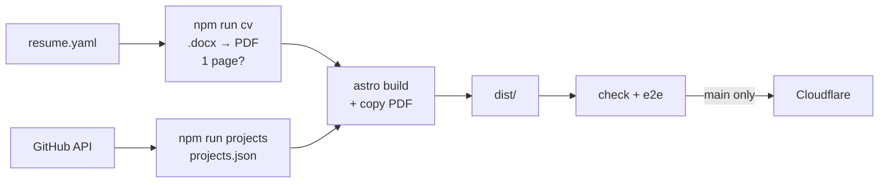

# Shahar Asher – Portfolio Site

Source code for my portfolio site. I'm a backend engineer (Java, Spring Boot, Kafka, real-time systems).

**Live:** https://personal-website.shaharasher.workers.dev

> **Work in progress.** The MVP is live; project deep-dive pages, a contact form and a custom domain are next
> (see [Roadmap](#roadmap)).

What the MVP contains:

- **Homepage** (`/`): Hero with the resume download, Experience (featured highlights), Projects (fetched from GitHub
  at build time), Skills, Contact (the email assembled in the browser, with a Copy button) and a footer.
- **Resume page** (`/resume`): the full resume in the site's styling, a Download PDF button and a print stylesheet.
- **Resume PDF** ([`/resume.pdf`](https://personal-website.shaharasher.workers.dev/resume.pdf)), generated from the
  same `resume.yaml` in CI.
- A styled **404 page**, dark and light themes (OS setting by default, saved toggle), an Open Graph image and site
  icons, `sitemap.xml`, `robots.txt` and `Person` JSON-LD.
- **Terminal view**: an opt-in alternate look (green monospace on black, `[links]`, dashed borders), switched by
  `>_ Terminal view` in the footer and saved like the theme. CSS and design tokens only; print never changes
  (design-doc §9.5).
- A hash-based **Content-Security-Policy** and security headers, and **Cloudflare Web Analytics** (no cookies).
- The workers.dev URL sends `X-Robots-Tag: noindex` until the site moves to its own domain, so it isn't indexed as a
  duplicate.

## Notable decisions

- **One source of truth for the resume.** All resume content lives in `src/data/resume.yaml`, validated
  against a schema. The Word and PDF files are generated from it, and site components may read it
  only through `src/lib/resume.ts`. That way the PDF and the site can't drift apart.
- **The phone number is in the PDF only: never in git, never on the site.** It comes from the `CV_PHONE`
  environment variable (`.env` locally, a GitHub Actions secret in CI). Three checks enforce this: it's
  not in any site file in `dist/`, it's not in any git-tracked file, and it *is* in the published PDF.
  This repo is meant to be public, so a pre-commit hook also blocks a commit whose staged content contains it, so
  it's caught before it's ever pushed, not after.
- **The email never appears as plain text in the built HTML**, to keep it away from scrapers. Components
  only get it as parts (`getEmailParts()`) to assemble in the browser, and a site check
  (`no-email-in-dist`) fails `npm run check`, and with it the deploy, if it leaks.
- **Near-zero JavaScript.** Pages are static. Simple interactions are `.astro` components with a small
  script, and React islands are reserved for complex ones. The homepage JS budget is < 30 KB gzipped,
  and a test enforces it.
- **The published PDF is built only in CI.** CI runs on a pinned `ubuntu-24.04` with LibreOffice and
  Liberation fonts, and fails if `fc-match Arial` doesn't resolve to Liberation Sans. That makes the PDF
  reproducible, and it matches the 2026-11-26 CV (Task 2.25).

The full reasoning behind these and every other decision is in [`docs/design-doc.md`](docs/design-doc.md).

## Stack

- [Astro](https://astro.build) + TypeScript (strict) + Tailwind CSS v4, built as a fully static site
- Self-hosted fonts (Inter, JetBrains Mono) through Astro's Fonts API
- Resume: [`docx`](https://docx.js.org) generates the Word file, and LibreOffice (headless) converts it to PDF
- Hosting: Cloudflare Workers (static assets)
- CI/CD: GitHub Actions
- Tests: `node:test` and Playwright. Code quality: ESLint and Prettier

## How it works



`npm run build` runs these steps in order:

1. **Resume:** validates `resume.yaml`, generates the `.docx` (adding the phone from `CV_PHONE`),
   converts it to PDF with LibreOffice, fails if the PDF isn't exactly one page, and finally copies it
   to `dist/resume.pdf`.
2. **Projects:** fetches my public GitHub repos and keeps the ones tagged with a `portfolio-*` topic,
   writing them to `src/data/projects.json` (generated, not committed). The build fails if a shown
   repo has no description or the API call fails.
3. **Site:** `astro build` produces static HTML in `dist/`. Fonts are downloaded at build time and
   served from the site itself, preloaded, with size-adjusted local fallbacks (`src/lib/font-fallbacks.mts`, the
   `@font-face` rules in `src/styles/global.css`). It also writes `sitemap.xml` and `robots.txt` (small endpoints in
   `src/pages/`). Every absolute URL (canonical, Open Graph, sitemap) comes from `site` in
   `astro.config.mjs`, so moving to another domain is a one-line change.
4. **Security headers:** `public/_headers` holds the response headers Cloudflare sends with every page and file.
   The Content-Security-Policy line in it is a placeholder that blocks everything. At the end of `astro build`, a small
   integration (`scripts/csp/csp.mts`) hashes every inline `<script>` and `<style>` in `dist/` and writes the real
   policy into `dist/_headers` (no `'unsafe-inline'`). It fails the build on anything a hash can't allow (a
   `style="..."` attribute, an `onclick=` handler, a `javascript:` URL), or if the file would break Cloudflare's limits
   (2,000 characters per line, 100 rules). Hashes are never edited by hand. Files under `/_astro/` (content-hashed
   names) are cached for a year (`Cache-Control: public, max-age=31536000, immutable`); nothing else is.

**The Open Graph image and the site icons** are generated from `resume.yaml` and the design tokens, and committed:
`public/og-image.png` (1200×630: name, title, tagline), `public/favicon.ico` (16, 32 and 48 px) and
`public/apple-touch-icon.png` (180 px), all showing the initials of `basics.name`, plus `public/favicon.svg`: the same
icon as JetBrains Mono outlines (read from the built font with the `fontkitten` devDependency), dark or light
through `prefers-color-scheme` inside the file, and its fixed variants `public/favicon-dark.svg` and
`public/favicon-light.svg`. With no saved choice the tab shows `favicon.svg` (it follows the browser); a saved theme,
or a click on the toggle, switches the icon link to that theme's variant, and terminal view to its own
`public/favicon-terminal.svg` (a green `>_` in the terminal colors). `/resume.pdf` always shows the `.ico`: the
browser's PDF viewer has no page `<head>` for the choice to reach (Chrome, Edge and Firefox use the SVG; Safari uses the `.ico`). They aren't rebuilt on every build. After changing one of
those inputs, run `npm run build`, then `npm run og` (it renders with the installed Edge, or Playwright's Chromium in
CI, using the built fonts), then `npm run build` again, and commit the new images. `npm test` fails while an image is
stale: a hash of its inputs is stored inside each PNG (and in a comment in each SVG) and compared with the current
ones. The OG image also carries one of the CTF chain's clues (below), so changing that clue makes it
stale the same way.

**A small CTF for the curious:** a chain of five clues, each pointing to the next and holding one part of a final
answer. They live in an HTML comment on the homepage, the DevTools console greeting, a response header, the OG
image's metadata and a file under `/.well-known/`. All clue texts and parts come from one module, `src/lib/ctf.mts`;
the build writes them out (`scripts/ctf/ctf-headers.mts` adds the header rule to `dist/_headers`, before the CSP
step). Nothing is linked from the pages, and the joined answer is never written in any file (`tests/ctf.test.ts`
checks that). No spoilers here: start with View Source.

**A small game on the 404 page:** "the lost page", a sheet of paper running home and jumping over ink blots, puddles
and staplers (Space or tap). It sits below the page's heading and Back to home, and nothing moves until the visitor
presses Play (or Space, like the Chrome dino). Only a small loader (about 1.3 KB gzipped) ships with the 404 page;
the game itself (`src/lib/game/`, about 3 KB gzipped) is imported on Play, and no other page loads either. The rules are a pure, seedable module (`src/lib/game/engine.ts`)
with unit tests; the colors come from the theme tokens; with reduced motion it runs without its decorative motion
(design-doc §10.3).

**Doodles on a few special days:** New Year, Pi Day, Alan Turing's birthday, the Day of the Programmer (the 256th
day), Halloween, Hanukkah and (from Task 4.2) the site's launch day. On those days a small picture drawn in the Hero's
dots sits at the right end of the profile icons, from the day before to the day after (time zones). It's a link to
the day's Wikipedia article: hovering or focusing it plays a short animation once and shows a bubble explaining the
day; on touch, the first tap does that and the second opens the article. The daily scheduled build picks the doodle
(`src/lib/doodles/`), so other days ship no doodle markup or code at all. On a doodle day the homepage gets a small
loader (under 1 KB gzipped); the animation (about 1 KB) loads on the first hover, focus or tap, and never with
reduced motion.

To see any doodle on any day, build it into `dist-doodle/` (never deployed) and serve it with the real headers:

```
npm run build
npm run doodle -- halloween
```

Then open http://127.0.0.1:4323. The ids are `launch`, `new-year`, `pi-day`, `turing`, `programmers-day`,
`halloween` and `hanukkah`. `npm run doodle:build -- <id>` only builds (default `pi-day`, the one the e2e tests use).
With `npm run dev`, set `DOODLE` first (cmd: `set DOODLE=halloween&& npm run dev`, PowerShell: `$env:DOODLE='halloween';
npm run dev`). A build into `dist/` fails while `DOODLE` is set, so a forced doodle can't reach the live site.

**Motion** (design-doc §10): a short crossfade between pages (the browser's native cross-document View Transitions,
CSS only: every navigation is still a full page load) and on switching the theme or terminal view; the homepage
sections after the Hero fade in once as they scroll into view (`src/components/SectionReveal.astro`,
`src/lib/reveal.ts`); project cards lift 2px on hover. Only `transform` and `opacity`, and none of it with reduced
motion. Nothing is hidden in the HTML: without JS, in print and with reduced motion every section is simply there.

In CI, every pull request goes through build → `npm run check` → Playwright e2e. After it's merged, the
same run on `main` repeats them and then deploys to Cloudflare (see [Contributing and deploy flow](#contributing-and-deploy-flow)).

## Running locally

Prerequisites:

- **Node 22.23.4+** (see `.nvmrc`; `package.json` requires `>=22.23.4 <23`, because Astro 7.4.4+ refuses to start on
  older Node)
- **LibreOffice 24.2+**. `npm run cv` looks for `soffice` in this order: the `SOFFICE_PATH` env var,
  then `C:\Program Files\LibreOffice\program\soffice.exe`, then `soffice` on the `PATH`
- **Microsoft Edge**, for the e2e tests and screenshots (local runs use the installed Edge, while CI
  uses Playwright's Chromium)
- **Network access** during the build (GitHub API and the font downloads)
- A **`.env`** file copied from `.env.example`:
  - `CV_PHONE`: the phone number for the resume. If it isn't set, `npm run build` warns and generates
    the resume without a phone, and the phone checks in `npm run check` print a warning and are skipped
    (in CI, a missing `CV_PHONE` fails the build). If you set it after building, run `npm run build`
    again, or `npm run check` fails because the PDF has no phone.
  - `GITHUB_TOKEN` (optional): without it, the GitHub API is called unauthenticated (60 requests/hour).
  - `SOFFICE_PATH` (optional): see above.

```
npm ci
npm run build
npm run preview
```

During development, `npm run dev` starts the dev server with hot reload.

**Analytics.** Production builds load the Cloudflare Web Analytics beacon on every page (`src/lib/analytics.ts`).
`npm run dev` never does. A local production build served by `npm run preview` or `npx wrangler dev` does load it.
Its reports from `127.0.0.1` most likely aren't counted, since the dashboard site matches the workers.dev hostname.
The e2e tests and screenshots block every request to `*.cloudflareinsights.com` (`tests/e2e/fixtures.ts`), so test
runs send nothing.

`npm run preview` doesn't send the headers from `_headers` (no CSP). To see the site exactly as Cloudflare serves it,
headers and the 404 page included, run `npx wrangler dev` after a build (local only, no login). The e2e tests use it.

**Git hooks.** `npm ci` (or `npm install`) runs `npm run prepare`, which points git at the
committed `.githooks/` folder (`git config core.hooksPath .githooks`). It holds two hooks.

The **pre-push** hook refuses any push that would update or delete `main` and prints the branch + PR steps
instead (see [Contributing and deploy flow](#contributing-and-deploy-flow)). Pushes of any other branch,
tag or branch deletion go through. Its logic is `scripts/git/push-policy.ts`.

The **pre-commit** hook checks the staged
content of every added or modified file (the index, not the files on disk; binary files are skipped)
for the `CV_PHONE` number and blocks the commit if it's there, printing only `file:line`. It needs
`.env` with `CV_PHONE` set: without it, every commit is blocked until you create `.env` from
`.env.example`. Never bypass it with `git commit --no-verify`. In CI, `prepare` prints a line and does
nothing. To run the same check by hand: `npm run check:staged`.

## Scripts

| Command | What it does |
|---|---|
| `npm run dev` | Astro dev server |
| `npm run build` | Full build: `cv` → `projects` → `astro build` (which writes the CSP into `dist/_headers`) → copy the PDF to `dist/resume.pdf` |
| `npm run preview` | Serve the production build from `dist/` (without the `_headers` headers; `npx wrangler dev` sends them) |
| `npm run cv` | Validate `resume.yaml`, generate the `.docx` and `.pdf` into `.generated/cv/`, check the PDF is one page |
| `npm run projects` | Fetch the tagged GitHub repos into `src/data/projects.json` |
| `npm run og` | Render `public/og-image.png`, `public/favicon.ico`, `public/favicon.svg` (+ `favicon-dark.svg`, `favicon-light.svg`, `favicon-terminal.svg`) and `public/apple-touch-icon.png` from `resume.yaml` and the design tokens (needs a build first, for the fonts) |
| `npm test` | Unit and integration tests (`node:test`, `tests/**/*.test.ts`) |
| `npm run test:update-golden` | Re-record the golden Word files that pin the resume design (only after an intended design change) |
| `npm run test:e2e` | Playwright end-to-end tests against the existing builds (`wrangler dev` with the real headers: `dist/` on port 4322, `dist-doodle/` on 4323, so run `npm run doodle:build` first) |
| `npm run test:e2e:linux` | The same e2e suite on Linux in Docker, as close to CI as practical, against the existing `dist/` and `dist-doodle/` (Docker Desktop must be running; see [Linux e2e](#linux-e2e-docker)). Extra args go to Playwright: `npm run test:e2e:linux -- tests/e2e/motion.spec.ts --repeat-each=10` |
| `npm run test:e2e:linux:clean` | Remove this project's e2e Docker image(s) and its Linux `node_modules` volume (the next run rebuilds them) |
| `npm run screenshots` | Review screenshots (375px, 640px and 1280px, dark, light and terminal view, plus header clips, the `/resume` print preview, the OG image and the icons) into `screenshots/` |
| `npm run doodle -- <id>` | Build `dist-doodle/` with that doodle forced (after `npm run build`), then serve it at http://127.0.0.1:4323 with the real headers |
| `npm run doodle:build -- <id>` | Only build `dist-doodle/` with that doodle (default `pi-day`): `astro build` alone, reusing the main build's outputs. CI runs it for the tests; it's never deployed |
| `npm run screenshots:doodles` | Review screenshots of every doodle (375px and 1280px, dark, light and terminal view, closed and with the bubble open), building `dist-doodle/` for each in turn |
| `npm run test:live` | Live smoke run: a read-only subset of the e2e specs against the deployed site (`playwright.live.config.ts`) |
| `npm run screenshots:live` | The same review screenshots, taken from the deployed site |
| `npm run check` | On an existing build: `astro check` → lint → `npm test` → site checks → format check |
| `npm run check:site` | Site checks: no phone in `dist/` or tracked files, phone present in the published PDF, no email in `dist/` |
| `npm run check:staged` | The pre-commit check: no `CV_PHONE` number in staged changes (fails if `CV_PHONE` isn't set) |
| `npm run prepare` | Runs on `npm ci`/`npm install`: installs the git hooks (`core.hooksPath` → `.githooks`); does nothing in CI, or with `SKIP_GIT_HOOKS=1` (set by `test:e2e:linux`'s container, so git never runs there) |
| `npm run lint` | ESLint |
| `npm run format` | Prettier, writing the fixes |
| `npm run format:check` | Prettier, check only |
| `npm run astro` | The Astro CLI (e.g. `npm run astro -- --help`) |

## Testing and CI

- **`npm test`** (`node:test`, no extra test framework): the resume schema, the generator's output
  compared against golden files, the GitHub fetch against a local fake server, the site checks
  (using a made-up phone number), design tokens and contrast, and checks on the built HTML. Tests
  that need LibreOffice skip with a message if `soffice` isn't found, and tests that read `dist/`
  skip if there's no build.
- **`npm run test:e2e`** (Playwright): behavior that needs a real browser, such as the theme toggle,
  saving the chosen theme, no flash on reload, keyboard navigation and focus states, reduced motion,
  layout at 375px and 1280px (in terminal view too), and the self-hosted fonts. They run against `wrangler dev`, so every page gets the real
  CSP: a test fails on any CSP violation, and one checks that an injected inline script is blocked. Every spec takes
  `test` from `tests/e2e/fixtures.ts`, which blocks Cloudflare Web Analytics requests, so test runs send no visits.
- **`npm run test:live`** (Playwright, run by hand after a deploy): reuses the CSP and headers, analytics, SEO, 404,
  Hero, resume, console greeting, CTF, 404 game and motion specs against the live URL (`site` in `astro.config.mjs`, so it follows a domain change). It
  checks status codes, every header from `public/_headers`, that the console has no CSP or header errors, the theme
  toggle, Copy, the PDF download, the OG image and icons, `sitemap.xml` and `robots.txt`. Nothing is started
  locally and no build is needed. Analytics requests are blocked as in every e2e run, so it sends no Web Analytics
  visits. Results go to `test-results/live/` and `playwright-report/live/`.
- **`npm run test:e2e:linux`**: see [Linux e2e](#linux-e2e-docker) below.
- **Site checks** (part of `npm run check`): see `check:site` above. The resume being one page and every
  shown repo having a description are checked during the build itself.

The workflow (`.github/workflows/deploy.yml`) runs on pull requests, on pushes to `main`, once a day
(so GitHub project changes and the day's doodle appear without a commit), and manually. After the build it also
builds `dist-doodle/` (`npm run doodle:build`) for the doodle tests; the deploy reads `dist/` only. **Any failing step blocks the
deploy:** the Liberation Sans font check, the build, `npm run check` or the e2e tests. The deploy step
only runs on `main`, so pull requests are built and checked but never deployed.

### Linux e2e (Docker)

Fonts and text layout differ between Windows and CI's Linux runner (no Arial or Courier New on Linux, whole-pixel text
layout), so e2e can pass on Windows and fail in CI. `npm run test:e2e:linux` runs the same suite on Linux first, as
close to CI's e2e step as practical. CI is unchanged and stays the gate.

- **Needs Docker Desktop running** (it says so and stops if Docker isn't found or isn't running), and an existing build:
  `npm run build` and `npm run doodle:build`. It reuses `dist/` and `dist-doodle/` from your machine (static files,
  the same on any OS) and fails with the usual "run npm run build first" message if one is missing.
- **What runs:** a container from the official Playwright image at the lockfile's `@playwright/test` version, with
  Node from `.nvmrc` and CI's `fonts-liberation` (`scripts/e2e-linux/Dockerfile`). Inside it, `CI=true` and
  `npm run test:e2e`, exactly CI's command: `wrangler dev` with the real headers, Playwright's Chromium, and
  `playwright.config.ts`'s worker count (1, as on CI).
- **Arguments** go to Playwright: `npm run test:e2e:linux -- tests/e2e/motion.spec.ts --repeat-each=10`, `-g`,
  `--workers=2` (fits in the container's 3 GB cap: about 1.6 GB at peak). Windows paths (`tests\e2e\…`) work too.
- **Results** land in the usual `test-results/` and `playwright-report/`.
- **What stays on disk:** the container is removed after every run. The image (`personal-website-e2e:…`, about
  3.8 GB, of which 3.6 GB is shared with the `mcr.microsoft.com/playwright` base image) and the Linux `node_modules`
  volume (`personal-website-e2e-node-modules`, about 0.7 GB) are kept, so later runs start in seconds. Your own
  `node_modules` is never touched. `npm ci` runs in the container only when `package-lock.json` (or the image)
  changed, with `SKIP_GIT_HOOKS=1` so the `prepare` script never runs git on your checkout.
- **Timing** (measured on 2026-11-20, 359 tests): first run about 13 minutes (image build, `npm ci`, the suite), later
  runs about 6 minutes, like `npm run test:e2e` on Windows.
- **Cleanup:** a Playwright upgrade builds a new image and removes this project's old one automatically.
  `npm run test:e2e:linux:clean` removes this project's image(s) and volume on demand, and nothing else. The base
  image (`mcr.microsoft.com/playwright:v<version>-noble`) and Docker's build cache aren't this project's alone, so they
  stay: remove them yourself with `docker image rm` and `docker builder prune` if nothing else uses them.

## Contributing and deploy flow

Nothing reaches `main`, or the live site, without passing every check. Every change goes through a branch
and a pull request (commands for Windows cmd):

```
git switch -c task/2-17-pr-workflow
git add <the changed files, listed one by one>
git commit -m "feat: short subject" -m "Body paragraph."
git push -u origin task/2-17-pr-workflow
gh pr create --fill --base main
```

Without the GitHub CLI (`gh`), open the "Create a pull request" link that `git push` prints.

1. **Name the PR as a commit.** PRs are squash merged, and the PR title becomes the one commit on `main`. So the
   title is a Conventional Commit (`feat:`, `fix:`, `docs:`, `test:`, `chore:`). `--fill` copies the
   commit's subject and body; check them before creating the PR.
2. **CI checks the PR.** The workflow's `build` job runs the build, `npm run check` and the e2e tests. It
   never deploys from a PR.
3. **Merge.** Once `build` is green and the branch is up to date with `main`, squash merge it on GitHub. GitHub
   then deletes the branch.
4. **Deploy.** The merge is a push to `main`. CI runs every check again on it and deploys only if they all pass.
   The daily scheduled run rebuilds and deploys `main` as before.
5. **Clean up locally.** Run these only after the PR shows "Merged". It's `-D`, because a squash merge
   leaves the branch's own commits off `main`:

   ```
   git switch main
   git pull
   git fetch --prune
   git branch -D task/2-17-pr-workflow
   ```

**Enforcement.**

- **On GitHub:** a ruleset on `main` requires a pull request, a passing `build` check and an up-to-date branch,
  and blocks force pushes and deletion. GitHub enforces rulesets on a private repo only on a paid plan, so it
  takes effect when the repo goes public.
- **Locally, always:** the pre-push hook (see [Git hooks](#running-locally)) refuses a push to `main`.
- **Not affected:** CI and the scheduled run never push, so neither the hook nor the ruleset touches them.

## Project docs

- [`docs/design-doc.md`](docs/design-doc.md): the decisions and why
- [`docs/plan.md`](docs/plan.md): the task list, with notes on what was done and how
- [`CLAUDE.md`](CLAUDE.md) and [`.claude/rules/`](.claude/rules/): working rules for this repo. I build it with Claude Code; these files are the rules it works under, and I review every plan and commit myself.

## Roadmap

The MVP is live and verified. Next: project deep-dive pages, a contact form, and a custom domain. Details
and status are in [`docs/plan.md`](docs/plan.md).
