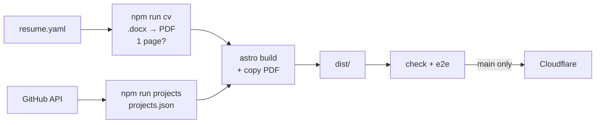

# Shahar Asher – Portfolio Site

Source code for my portfolio site. I'm a backend engineer (Java, Spring Boot, Kafka, real-time systems).

**Live:** https://personal-website.shaharasher.workers.dev

> **Work in progress.** The live site currently serves the resume at
> [`/resume.pdf`](https://personal-website.shaharasher.workers.dev/resume.pdf) and a placeholder
> homepage. The real sections are being built (see [Roadmap](#roadmap)).

## Notable decisions

- **One source of truth for the resume.** All resume content lives in `src/data/resume.yaml`, validated
  against a schema. The Word and PDF files are generated from it, and site components may read it
  only through `src/lib/resume.ts`. That way the PDF and the site can't drift apart.
- **The phone number is in the PDF only: never in git, never on the site.** It comes from the `CV_PHONE`
  environment variable (`.env` locally, a GitHub Actions secret in CI). Three checks enforce this: it's
  not in any site file in `dist/`, it's not in any git-tracked file, and it *is* in the published PDF.
- **The email never appears as plain text in the built HTML**, to keep it away from scrapers. Components
  only get it as parts (`getEmailParts()`) to assemble in the browser, and a site check
  (`no-email-in-dist`) fails `npm run check`, and with it the deploy, if it leaks.
- **Near-zero JavaScript.** Pages are static. Simple interactions are `.astro` components with a small
  script, and React islands are reserved for complex ones. The homepage JS budget is < 30 KB gzipped,
  and a test enforces it.
- **The published PDF is built only in CI.** CI runs on a pinned `ubuntu-24.04` with LibreOffice and
  Liberation fonts, and fails if `fc-match Arial` doesn't resolve to Liberation Sans. That makes the PDF
  reproducible and pixel-identical to the original resume design.

The full reasoning behind these and every other decision is in [`docs/design-doc.md`](docs/design-doc.md)
(in Hebrew).

## Stack

- [Astro](https://astro.build) + TypeScript (strict) + Tailwind CSS v4, built as a fully static site
- Self-hosted fonts (Inter, JetBrains Mono) through Astro's Fonts API
- Resume: [`docx`](https://docx.js.org) generates the Word file, and LibreOffice (headless) converts it to PDF
- Hosting: Cloudflare Workers (static assets)
- CI/CD: GitHub Actions
- Tests: `node:test` and Playwright. Code quality: ESLint and Prettier

## How it works



`npm run build` runs these steps in order:

1. **Resume:** validates `resume.yaml`, generates the `.docx` (adding the phone from `CV_PHONE`),
   converts it to PDF with LibreOffice, fails if the PDF isn't exactly one page, and finally copies it
   to `dist/resume.pdf`.
2. **Projects:** fetches my public GitHub repos and keeps the ones tagged with a `portfolio-*` topic,
   writing them to `src/data/projects.json` (generated, not committed). The build fails if a shown
   repo has no description or the API call fails.
3. **Site:** `astro build` produces static HTML in `dist/`. Fonts are downloaded at build time and
   served from the site itself.

In CI, a pushed commit goes through build → `npm run check` → Playwright e2e → deploy to Cloudflare
(`main` only).

## Running locally

Prerequisites:

- **Node 22** (see `.nvmrc`; `package.json` requires `>=22.22.0 <23`)
- **LibreOffice 24.2+**. `npm run cv` looks for `soffice` in this order: the `SOFFICE_PATH` env var,
  then `C:\Program Files\LibreOffice\program\soffice.exe`, then `soffice` on the `PATH`
- **Microsoft Edge**, for the e2e tests and screenshots (local runs use the installed Edge, while CI
  uses Playwright's Chromium)
- **Network access** during the build (GitHub API and the font downloads)
- A **`.env`** file copied from `.env.example`:
  - `CV_PHONE`: the phone number for the resume. If it isn't set, `npm run build` warns and generates
    the resume without a phone, and the phone checks in `npm run check` print a warning and are skipped
    (in CI, a missing `CV_PHONE` fails the build). If you set it after building, run `npm run build`
    again, or `npm run check` fails because the PDF has no phone.
  - `GITHUB_TOKEN` (optional): without it, the GitHub API is called unauthenticated (60 requests/hour).
  - `SOFFICE_PATH` (optional): see above.

```
npm ci
npm run build
npm run preview
```

During development, `npm run dev` starts the dev server with hot reload.

## Scripts

| Command | What it does |
|---|---|
| `npm run dev` | Astro dev server |
| `npm run build` | Full build: `cv` → `projects` → `astro build` → copy the PDF to `dist/resume.pdf` |
| `npm run preview` | Serve the production build from `dist/` |
| `npm run cv` | Validate `resume.yaml`, generate the `.docx` and `.pdf` into `.generated/cv/`, check the PDF is one page |
| `npm run projects` | Fetch the tagged GitHub repos into `src/data/projects.json` |
| `npm test` | Unit and integration tests (`node:test`, `tests/**/*.test.ts`) |
| `npm run test:update-golden` | Re-record the golden Word files that pin the resume design (only after an intended design change) |
| `npm run test:e2e` | Playwright end-to-end tests against the existing build (`astro preview` on port 4322) |
| `npm run screenshots` | Review screenshots (375px and 1280px, dark and light) into `screenshots/` |
| `npm run check` | On an existing build: `astro check` → lint → `npm test` → site checks → format check |
| `npm run check:site` | Site checks: no phone in `dist/` or tracked files, phone present in the published PDF, no email in `dist/` |
| `npm run lint` | ESLint |
| `npm run format` | Prettier, writing the fixes |
| `npm run format:check` | Prettier, check only |
| `npm run astro` | The Astro CLI (e.g. `npm run astro -- --help`) |

## Testing and CI

- **`npm test`** (`node:test`, no extra test framework): the resume schema, the generator's output
  compared against golden files, the GitHub fetch against a local fake server, the site checks
  (using a made-up phone number), design tokens and contrast, and checks on the built HTML. Tests
  that need LibreOffice skip with a message if `soffice` isn't found, and tests that read `dist/`
  skip if there's no build.
- **`npm run test:e2e`** (Playwright): behavior that needs a real browser, such as the theme toggle,
  saving the chosen theme, no flash on reload, keyboard navigation and focus states, reduced motion,
  layout at 375px and 1280px, and the self-hosted fonts.
- **Site checks** (part of `npm run check`): see `check:site` above. The resume being one page and every
  shown repo having a description are checked during the build itself.

The workflow (`.github/workflows/deploy.yml`) runs on pull requests, on pushes to `main`, once a day
(so GitHub project changes appear without a commit), and manually. **Any failing step blocks the
deploy:** the Liberation Sans font check, the build, `npm run check` or the e2e tests. The deploy step
only runs on `main`, so pull requests are built and checked but never deployed.

## Project docs

- [`docs/design-doc.md`](docs/design-doc.md): the decisions and why (in Hebrew)
- [`docs/plan.md`](docs/plan.md): the task list, with notes on what was done and how
- [`CLAUDE.md`](CLAUDE.md) and [`.claude/rules/`](.claude/rules/): working rules for this repo. I build it with Claude Code; these files are the rules it works under, and I review every plan and commit myself.

## Roadmap

Next: the homepage sections (hero, experience, projects, skills, contact), a `/resume` page, SEO, and
security headers. After that: project deep-dive pages, a contact form, and a custom domain. Details
and status are in [`docs/plan.md`](docs/plan.md).
